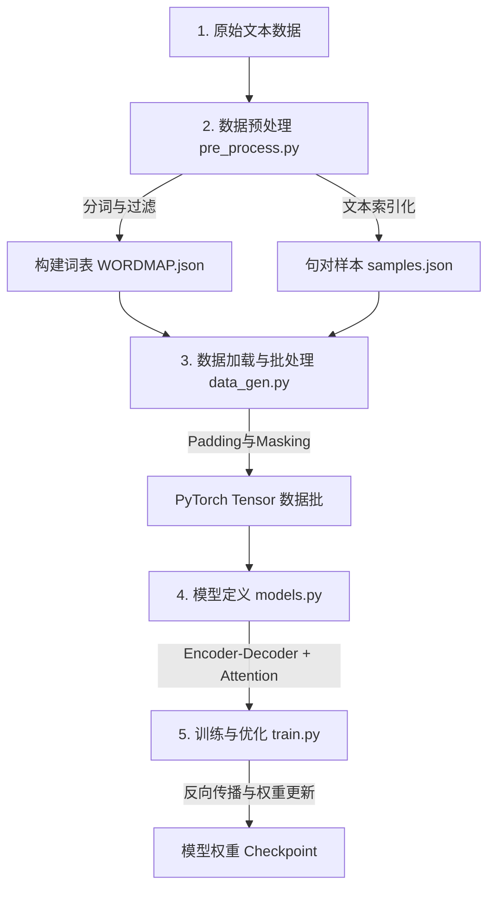

# 聊天机器人机器学习项目学习指南

欢迎来到机器学习和 PyTorch 的世界！本项目实现了一个经典的**基于 Seq2Seq 架构和 Luong Attention 机制的中文聊天机器人**。

下面是整个项目的宏观工作流图解和关键知识点梳理，可以作为你阅读代码时的参考手册。

---

## 1. 机器学习核心工作流

在本项目中，聊天机器人的构建遵循了标准的 NLP（自然语言处理）工作流：



---

## 2. 核心概念与关键技术解释

### 2.1 文本如何变成计算机认识的数字？
计算机无法直接处理“你好”、“吃了吗”这样的中文。我们需要通过三步进行**文本索引化（Indexation）**：
1. **分词（Tokenization）**：使用 `jieba` 将连续的中文句子切分成词语列表。例如：“我喜欢机器学习” -> `["我", "喜欢", "机器", "学习"]`。
2. **构建词表（Vocabulary Map）**：统计所有词语的出现次数，过滤掉低频词，然后给每个词分配一个唯一的整数 ID。同时加入 4 个特殊词：
   - `<pad>` (ID 0): 用于填充短句子以对齐批次长度。
   - `<start>` (ID 1): 标记句子的开始（SOS）。
   - `<end>` (ID 2): 标记句子的结束（EOS），告诉模型该停止输出了。
   - `<unk>` (ID 3): 代表未在词表中出现的未知词（Out Of Vocabulary）。
3. **数值化**：将句子转化为 ID 列表。例如：`[1, 14, 256, 99, 2]`。

### 2.2 为什么要进行 Padding（补零）和 Masking（掩码）？
由于深度学习需要进行高效的矩阵乘法，在一个 Batch（批次，如 64 个句子）中，**所有句子的长度必须一致**。
- **Padding（填充）**：找出 Batch 中最长句子的长度，将较短的句子用 `<pad>` (ID 0) 在尾部填满。
- **Masking（遮蔽）**：因为 `<pad>` 是我们强行加入的无意义字符，我们不希望模型计算它产生的损失。因此我们生成一个与数据等大的 `Mask` 矩阵（有效词为 1，`<pad>` 处为 0），在计算 Loss 时，只计算有效词的损失。

### 2.3 什么是 pack_padded_sequence？
在 RNN（GRU/LSTM）中，若传入含有大量 `<pad>` 的句子，RNN 会继续对无意义的 0 向量进行多余的前向计算，这不仅浪费性能，还会引入噪声。
- `pack_padded_sequence` 可以把填充后的稀疏 Tensor 压缩成一个紧凑的数据结构，只让 RNN 处理有效长度。
- 计算完毕后，再用 `pad_packed_sequence` 还原为带填充的普通 Tensor。
- **注意**：PyTorch 默认要求输入 Batch 按照句子有效长度**从大到小降序排列**，才能进行 `pack_padded_sequence`。这也是我们在 `data_gen.py` 中对 Batch 进行 `sort` 的原因。

### 2.4 Seq2Seq + Attention 架构
这是项目的灵魂：
```
  输入句: "你" "好" "吗" ---> [Encoder (双向GRU)] 
                                   | (编码成上下文向量)
                                   v
  输出句: "我" "很" "好" <--- [Decoder (单向GRU)] <--- [Luong Attention 机制]
```
1. **Encoder（编码器）**：读取输入的问句，将其转化为一系列隐藏状态（Hidden States）。这里采用了双向 GRU，使得每个词不仅包含前文信息，也包含后文信息。
2. **Attention（注意力机制）**：人类在回答问题或翻译时，会重点关注问题中的某些特定词。Attention 机制允许 Decoder 在生成每一个词时，去计算它和 Encoder 所有输出词的相关性得分（权重），并把得分加权求和，得到一个“上下文向量（Context Vector）”。
3. **Decoder（解码器）**：根据上一步输出的词、当前的隐状态、以及 Attention 计算出的上下文向量，去预测下一个最可能输出的词。

### 2.5 训练中的黑科技
- **Teacher Forcing（教师迫导）**：在训练初期，模型预测出的词通常是错的。如果一直用错的词作为下一步的输入，模型会错得越来越离谱，极难收敛。Teacher Forcing 指的是在训练时，以一定的概率（这里设为 1.0，即完全开启）**直接将真实的 Ground Truth 词作为 Decoder 的下一步输入**，像老师一样纠正模型的方向。
- **Gradient Clipping（梯度剪裁）**：RNN 极其容易产生梯度爆炸（网络层数很深时梯度变得极大导致 NaN）。梯度剪裁可以在梯度超过某个阀值（本项目设为 `50.0`）时，强行将其按比例缩小，确保训练稳定。

---

## 3. 项目各模块快速上手指南
- 数据处理入口：[pre_process.py](pre_process.py) (提取、清洗语料、切词、词表建立)
- 批数据生成器：[data_gen.py](data_gen.py) (加载 samples，切分 train/val 并生成 PyTorch 批数据)
- 神经网络定义：[models.py](models.py) (定义了 Encoder、Decoder 以及 Attention 层)
- 训练核心程序：[train.py](train.py) (模型训练、Teacher Forcing 决策、评估及权重保存)
- 配置文件中心：[config.py](config.py) (设备选择、超参数调整、根据命令行自动切语料配置)

接下来，你可以阅读各个核心文件的代码，里面已经附带了详细的中文注释。
