# 聊天机器人项目学习指南：经典书籍章节对照与技术吃透

本项目实现了一个基于 **Seq2Seq + Attention 机制** 的自回归对话模型（Chatbot）。为了能够从理论上彻底吃透本项目所使用的全部技术，我们建议对照《人工智能：现代方法》（AIMA 第4版）和《深度学习》（俗称“花书”）两本权威书籍，重点研读以下章节。

---

## 🗺️ 核心技术与书籍章节对照图谱

```mermaid
graph TD
    Project["Chatbot 核心实现"] --> Data["数据处理与词嵌入"]
    Project --> Seq2Seq["Seq2Seq & GRU 架构"]
    Project --> Attention["Attention 机制"]
    Project --> Opt["优化算法 & 梯度裁剪"]
    Project --> Loss["损失函数与评估解码"]
    Project --> Speedup["并行加载与混合精度加速"]
    Project --> Reg["泛化与去过拟合优化"]

    Data --> AIMA_24["AIMA 第 24 章: NLP 深度学习"]
    Data --> DL_12["花书 第 12 章: NLP 应用"]

    Seq2Seq --> AIMA_21["AIMA 第 21 章: 深度学习"]
    Seq2Seq --> DL_10["花书 第 10 章: 序列建模 (GRU/Teacher Forcing)"]

    Attention --> AIMA_21_6["AIMA 21.6: 注意力机制"]
    Attention --> AIMA_24_4["AIMA 24.4: 机器翻译与注意力"]

    Opt --> DL_8["花书 第 8 章: 深度模型优化 (Adam/梯度裁剪)"]

    Loss --> DL_3["花书 第 3 章: 概率与信息论 (交叉熵)"]
    Loss --> DL_5["花书 第 5 章: 机器学习基础 (最大似然估计)"]

    Speedup --> DL_12_1["花书 第 12 章: 计算机实现与硬件加速 (DataLoader & pin_memory)"]
    Speedup --> DL_8_AMP["花书 第 8 章: 混合精度数值稳定性 (GradScaler)"]

    Reg --> DL_5_Reg["花书 第 5 章: 机器学习基础 (打乱切分与泛化误差)"]
    Reg --> DL_10_SS["花书 第 10 章: 序列自回归与暴露偏差 (计划采样)"]
```

---

## 🚀 循序渐进：由简入繁的学习路径 (Step-by-Step Learning Path)

为了让机器学习新人能有条不紊地攻克本项目，我们为你规划了一条从数学概念演进到复杂工程落地的**五阶段循序渐进学习路径**。建议你按照以下顺序依次阅读对应书籍章节并对照代码阅读：

### 阶段一：筑基 —— 机器学习与数学基础 (1~2天)
*   **学习重点**：神经网络是如何学习的？如何科学衡量它的好坏？
*   **核心问题**：
    1.  什么是**监督学习**？训练集和验证集为什么要打乱（Shuffle）后切分？（对应项目中的 [data_gen.py](file:///D:/Repos/Chatbot/data_gen.py#L152-L162)）
    2.  什么是**交叉熵（Cross-Entropy）**？它和概率分布有什么关系？（对应项目中的 [utils.py:maskNLLLoss](file:///D:/Repos/Chatbot/utils.py#L21)）
*   **学习步骤**：
    1.  阅读 **《深度学习》（花书）第 3.13 节**：吃透交叉熵的公式与物理意义。
    2.  阅读 **《深度学习》（花书）第 5.1 ~ 5.3 节**：理解容量、欠拟合、过拟合以及为什么训练数据必须独立同分布（I.I.D.）。

### 阶段二：桥梁 —— 文本数字化的艺术 (2~3天)
*   **学习重点**：计算机只懂数字，离散的中文文字是如何变成矩阵输入神经网络的？
*   **核心问题**：
    1.  分词（Jieba）的作用是什么？为什么需要构建词表（Word Map）？（对应项目中的 [pre_process.py](file:///D:/Repos/Chatbot/pre_process.py#L63)）
    2.  什么是**词嵌入（Embedding）**？它为什么比传统的独热编码（One-Hot）更好？（对应项目中的 `nn.Embedding` [train.py](file:///D:/Repos/Chatbot/train.py#L274)）
    3.  句子长短不一，如何用 `<pad>` 填充对齐？如何用掩码（Mask）让模型忽略填充字符？（对应项目中的 [utils.py:maskNLLLoss](file:///D:/Repos/Chatbot/utils.py#L21)）
*   **学习步骤**：
    1.  阅读 **《人工智能：现代方法》（AIMA）第 24.1 ~ 24.2 节**：理解词向量的演进，以及语义空间距离的几何意义。
    2.  阅读 **《深度学习》（花书）第 12.4 节**：理解自然语言处理中词嵌入矩阵的参数更新方式。

### 阶段三：主线 —— 时序特征抽取与循环网络 (3~4天)
*   **学习重点**：如何处理有先后顺序的文本序列？
*   **核心问题**：
    1.  传统 RNN 是如何传递隐藏状态（Hidden State）的？为什么长句子会发生**梯度消失**？
    2.  **门控循环单元（GRU）** 内部的更新门和重置门是如何解决长期依赖问题的？（对应项目中的 [models.py:EncoderRNN](file:///D:/Repos/Chatbot/models.py#L15)）
    3.  什么是**导师迫导（Teacher Forcing）**？它为什么能加速训练？（对应项目中的 [train.py](file:///D:/Repos/Chatbot/train.py#L100)）
*   **学习步骤**：
    1.  阅读 **《深度学习》（花书）第 10.1 ~ 10.2 节**：深入理解 RNN 展开计算图及 Teacher Forcing。
    2.  阅读 **《深度学习》（花书）第 10.7 节 & 第 10.10 节**：搞明白梯度消失问题，重点啃下 GRU 的门控公式。

### 阶段四：跃升 —— 从 Seq2Seq 架构到 Attention 机制 (4~5天)
*   **学习重点**：聊天机器人是如何生成一句新对话的？
*   **核心问题**：
    1.  **Encoder-Decoder（Seq2Seq）** 结构是如何连接两个变长序列的？中间的“信息瓶颈”是什么？
    2.  **注意力机制（Attention）** 是如何打破这个瓶颈，让 Decoder 在生成每个词时去“看” Encoder 的不同部分的？（对应项目中的 [models.py:LuongAttnDecoderRNN](file:///D:/Repos/Chatbot/models.py#L76)）
    3.  在生成回复时，如何用自回归和**贪心搜索（Greedy Search）**逐字解码？（对应项目中的 [utils.py:GreedySearchDecoder](file:///D:/Repos/Chatbot/utils.py#L50)）
*   **学习步骤**：
    1.  阅读 **《人工智能：现代方法》（AIMA）第 24.4 节**：理解机器翻译/对话的 Seq2Seq 框架。
    2.  阅读 **《人工智能：现代方法》（AIMA）第 21.6 节**：学习 Query、Key、Value 对注意力的建模方法。

### 阶段五：飞跃 —— 工程落地、优化与调优 (3~5天)
*   **学习重点**：如何让模型训练得更快？如何消除暴露偏差让它说出流利的人话？
*   **核心问题**：
    1.  **Adam 优化器** 为什么比传统 SGD 收敛更快？（对应项目中的 `optim.Adam` [train.py](file:///D:/Repos/Chatbot/train.py#L290)）
    2.  多进程 **DataLoader**、`pin_memory` 以及 `persistent_workers` 是如何消除数据加载瓶颈的？（对应项目中的 [train.py](file:///D:/Repos/Chatbot/train.py#L252)）
    3.  什么是**自动混合精度（AMP）**？为什么需要 `GradScaler` 梯度缩放？（对应项目中的 `GradScaler` [train.py](file:///D:/Repos/Chatbot/train.py#L361)）
    4.  什么是**暴露偏差（Exposure Bias）**？为什么必须使用**计划采样（Scheduled Sampling）**？（对应项目中的 [train.py](file:///D:/Repos/Chatbot/train.py#L373)）
*   **学习步骤**：
    1.  阅读 **《深度学习》（花书）第 8.5.3 节**：吃透 Adam 优化算法。
    2.  阅读 **《深度学习》（花书）第 12.1 节**：搞懂 CPU-GPU 数据传输通道，理解异步加载必要性。
    3.  阅读 **《深度学习》（花书）第 10.2.1 节**：深入理解暴露偏差的理论缺陷，掌握计划采样策略。

---

## 📚 详细学习目录

### 1. 词嵌入与数据表示 (Embeddings & Data Prep)
* **项目概念**：[nn.Embedding](file:///D:/Repos/Chatbot/train.py#L220)（将词 ID 转换为向量空间稠密表征）、`<pad>` 对齐填充、掩码 Mask 机制。
* **《人工智能：现代方法》对应章节**：
  * **第 24.1 节 (Grammar and Language Models)**：理解词表（Vocabulary）与语言模型的基本定义。
  * **第 24.2 节 (Word Embeddings)**：重点理解从 One-Hot 稀疏编码到 Word2Vec 等分布式表示的物理演进与数学动机。
* **《深度学习》（花书）对应章节**：
  * **第 12.4 节 (Natural Language Processing)**：理解神经网络语言模型的原理，词向量是如何通过参数矩阵隐式学习并优化的。

### 2. 循环神经网络与门控单元 (GRU & Sequence Modeling)
* **项目概念**：[EncoderRNN](file:///D:/Repos/Chatbot/models.py#L15) 双向 GRU 编码、[LuongAttnDecoderRNN](file:///D:/Repos/Chatbot/models.py#L76) 解码、`teacher_forcing_ratio`。
* **《人工智能：现代方法》对应章节**：
  * **第 21.3 节 (Recurrent Neural Networks)**：循环神经网络（RNN）的工作原理，包括隐藏状态（Hidden State）更新。
  * **第 24.3 节 (Recurrent Neural Networks for NLP)**：学习 RNN 如何对变长输入文本进行编码，理解输入序列长度一维张量（Lengths）的重要作用。
* **《深度学习》（花书）对应章节**：
  * **第 10.1~10.2 节 (Recurrent Neural Networks)**：深入公式级推导循环神经网络的展开计算图与梯度传播过程。重点理解 **Teacher Forcing（导师迫导）** 在训练阶段的作用与优缺点。
  * **第 10.7 节 (The Challenge of Long-Term Dependencies)**：了解循环网络中致命的梯度消失和梯度爆炸原理。
  * **第 10.10 节 (Gated RNNs)**：重点吃透 **门控循环单元（GRU）** 及其门控公式（更新门、重置门），理解它们为什么能抑制梯度消失并捕捉长期记忆。

### 3. 注意力机制 (Attention Mechanism)
* **项目概念**：Luong Attention（点积注意力 `dot`），双向编码信息融合。
* **《人工智能：现代方法》对应章节**：
  * **第 21.6 节 (Attention)**：注意力机制的核心物理直觉，Query, Key, Value 的概念。
  * **第 24.4 节 (Sequence-to-Sequence Models)**：理解传统 Encoder-Decoder 架构的信息瓶颈，以及引入 Attention 如何实现跨时序的信息对齐与融合。

### 4. 优化算法与数值稳定性 (Adam & Gradient Clipping)
* **项目概念**：`optim.Adam` 优化器、`clip` 梯度裁剪。
* **《深度学习》（花书）对应章节**：
  * **第 8.5.3 节 (Adam)**：透彻学习 Adam 优化器算法，理解它如何结合动量（Momentum）和自适应二阶矩（RMSProp）自适应调整学习率。
  * **第 8.7.1 节 (Clipping Gradients)**：深入理解为了防止隐藏层在时间步过长时出现数值溢出（梯度爆炸），通过 `clip_grad_norm_` 或阈值裁剪强制收缩梯度向量模长的数学道理。

### 5. 损失函数与最大似然评估 (Cross-Entropy & Search Decoding)
* **项目概念**：[maskNLLLoss](file:///D:/Repos/Chatbot/utils.py#L21) 损失函数（负对数似然损失 + 掩码过滤）、[GreedySearchDecoder](file:///D:/Repos/Chatbot/utils.py#L50)（自回归贪心搜索预测）。
* **《深度学习》（花书）对应章节**：
  * **第 3.13 节 (Information Theory)**：从信息论角度理解熵（Entropy）与交叉熵（Cross-Entropy）的物理本质。
  * **第 5.5 节 (Maximum Likelihood Estimation)**：彻底搞清楚为什么分类任务和序列概率建模要最大化对数似然，以及它与最小化交叉熵损失在数学上的等价性。

### 6. 并行数据加载与训练加速优化 (Parallel Data Loading & Training Speedup)
* **项目概念**：[DataLoader](file:///D:/Repos/Chatbot/train.py#L252-L267) 异步加载、`autocast`/`GradScaler` 自动混合精度 (AMP) 训练、`torch.compile` 图编译与算子融合。
* **《人工智能：现代方法》对应章节**：
  * **第 21.2 节 (Computational Graph & Hardware)**：理解计算图的构建机制以及硬件加速计算（Tensor Cores，混合精度计算基础）的物理基础。
* **《深度学习》（花书）对应章节**：
  * **第 12.1 节 (Computer Implementations)**：系统学习深度学习模型在计算机硬件中的运行方式，理解 CPU 与 GPU 之间数据传输的通道和延迟机制，从而搞清楚为什么需要多进程预加载（DataLoader）与锁页内存（pin_memory）。
  * **第 8.1.1 节 (Optimization Challenges - Numerical Precision)**：探讨在梯度计算中使用不同数值精度可能带来的下溢与上溢挑战，理解 `GradScaler` 对半精度计算梯度的缩放恢复原理。

### 7. 泛化性、偏差与去过拟合优化 (Generalization, Bias & Overfitting Prevention)
* **项目概念**：[ChatbotDataset](file:///D:/Repos/Chatbot/data_gen.py#L152-L162) 全局随机打乱（Seed-Shuffle）、[Scheduled Sampling](file:///D:/Repos/Chatbot/train.py#L371-L377)（计划采样 / 教师迫导渐进式衰减）。
* **《人工智能：现代方法》对应章节**：
  * **第 19.4 节 (Generalization and Overfitting)**：学习过拟合的概念、测试集/训练集分布一致性的重要性。
* **《深度学习》（花书）对应章节**：
  * **第 5.2 节 (Capacity, Overfitting and Underfitting)**：系统性学习泛化误差、训练误差的概念。理解如果数据不打乱切分，可能导致严重的采样偏差（Selection Bias），从而使验证集和训练集不满足独立同分布（I.I.D.）假设，极易引发假性过拟合或评估失准。
  * **第 10.2.1 节 (Teacher Forcing and Networks with Output Feedback)**：重点研读 Teacher Forcing 导致训练和推理时输入分布不一致的问题（即**暴露偏差 Exposure Bias**），理解为什么需要引入 **计划采样（Scheduled Sampling / Curriculum Learning）** 这一过渡机制来平滑模型在测试阶段的表现。
